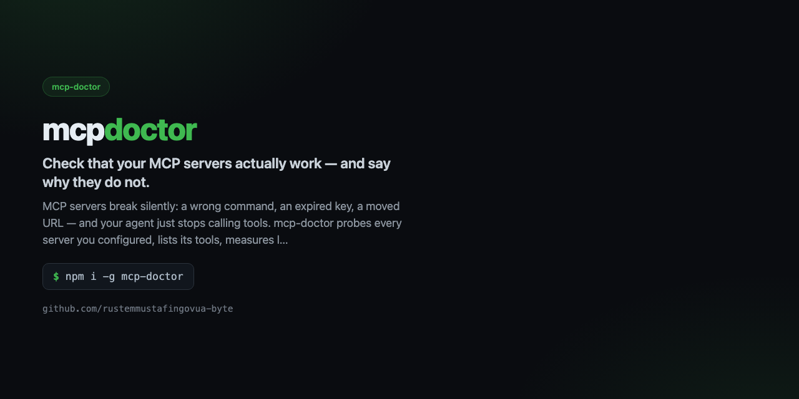

<div align="center">



# mcp-doctor

**Check that your MCP servers actually work — and say why they do not.**

[](https://github.com/rustemmustafingovua-byte/mcp-doctor/actions/workflows/ci.yml)
[](https://www.npmjs.com/package/mcp-doctor)
[](./LICENSE)
[](https://nodejs.org)
[](https://base.org)

[**Docs**](https://rustemmustafingovua-byte.github.io/mcp-doctor/) · [Issues](https://github.com/rustemmustafingovua-byte/mcp-doctor/issues) · [Discussions](https://github.com/rustemmustafingovua-byte/mcp-doctor/discussions)

</div>

---

MCP servers break silently: a wrong command, an expired key, a moved URL — and your agent just stops calling tools. mcp-doctor probes every server you configured, lists its tools, measures latency and tells you exactly what broke and how to fix it.

## Install

```bash
npm i -g mcp-doctor
```

## What it does

| | |
|---|---|
| **Probes stdio and streamable-HTTP servers** | starts the process, completes the MCP handshake, lists the tools |
| **Classifies the failure** | spawn / handshake / timeout / auth / empty — not a stack trace |
| **Reads your OpenCode config** | every enabled server in one pass, with latency |
| **Machine readable** | --json for CI |


## Usage

```bash
mcp-doctor
mcp-doctor --url https://example.com/mcp
mcp-doctor --json
```

## Part of a portfolio

| Project | What it does |
|---|---|
| [`opencode-free-stack`](https://github.com/rustemmustafingovua-byte/opencode-free-stack) | route to free models, fall back automatically |
| [`free-web-mcp`](https://github.com/rustemmustafingovua-byte/free-web-mcp) | web search for agents, zero credits |
| [`agent-x402`](https://github.com/rustemmustafingovua-byte/agent-x402) | pay per API call in USDC with a spend policy |

## Donate

MIT, forever. USDC on Base:

```
0x8aC6a229f254980CCd3Dd35CF5E1B7c08880B40E
```

## License

MIT © rustemmustafingovua-byte
